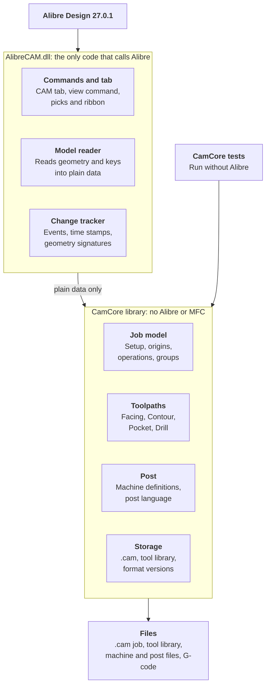

> Exported from the Claude doc "Alibre CAM Add-on: Version 1 Specification" on 4 November 2026 (rev 166).
> The Claude doc is the master copy: https://claude.ai/artifact/JZEKmxczFdEn2eV32A5acB
> The two diagrams are redrawn here in Mermaid, because they don't export from the doc.
> Update this copy after spec changes, or note here if it becomes the master.
# Alibre CAM Add-on: Version 1 Specification

Nov 3, 2026 · @Frank

## Overview

Version 1 is an Alibre Design add-on that generates indexed 3+2 cutting paths for components placed in an assembly and posts them as G-code. The first target is a LinuxCNC 3-axis router with an optional 4th axis.

| Area | In version 1 | Out of scope for now |
| --- | --- | --- |
| Workspace | Assemblies | Parts |
| Motion | Indexed positioning, with 3-axis cutting at each orientation | Simultaneous 4/5-axis motion, including continuous 4th-axis wrapping |
| Operations | Facing, Contour, Pocket, Drill | 3D roughing and finishing, V-carving, engraving, nesting |
| Origin sources | Picked geometry, stock presets | Existing Alibre coordinate systems |
| Regeneration | Started by the user | Automatic regeneration |
| Post-processing | Template-based post language | General scripting in posts |

## CAM tree and workflow

The add-on adds a CAM treeview as another tab in the Design Explorer, with fixed Setup items at the top and the user-built operation sequence below.


Operations run from top to bottom, and each one uses the most recent `Set Origin` step above it. The group names are examples.

The workflow has four steps:

1. Define the machine, tools, and stock in Setup.
2. Set the initial CAM origin.
3. Add operations and organize them into groups.
4. Change the origin when the workflow needs a new orientation.

Toolpaths are visible while the CAM tab has focus and hidden when it loses focus. They are redrawn from saved data, with no recalculation. A small toolbar above the CAM tree holds the view toggles as image buttons, pushed in while on, each with a tooltip: Draw over model sets whether they draw over the model or can be hidden by it, and Show toolpaths shows or hides every toolpath (boundaries and feature outlines stay). Both are on by default, and neither is saved in the .cam file. More toggles will join them. A Help button (?) and a gear button sit at the toolbar's right. Help, and a ? button at the bottom left of every dialog (left of all its buttons), open the add-on's help in the default browser at the section for the CAM tab, that dialog, or the operation dialog's showing tab. The help is a single HTML page, help\AlibreCAM.html, installed in a help folder beside the add-on; each section describes what it's for and each of its fields, with "To be completed." where that isn't known yet. The gear opens a modal Settings dialog (no tabs yet) with a CAM View Size group: Small (the default: Windows' GUI font and 16 pixel icons), Medium (text 1.25 times, 24 pixel icons) or Large (1.5 times, 32 pixel icons). The tab's text, its buttons and the toolbar icons all resize at once, the icons drawn at each size rather than stretched. The setting is saved per user in %APPDATA%\AlibreCAM\settings.json (a JSON file with its own format version); a damaged settings file, or one from a newer add-on, is left alone and the choice lasts until Alibre closes. A native command ends the display, and a Refresh button on the CAM tab brings it back.

## Stock

Stock can be defined in three ways, and any change to its definition marks dependent origins and operations as out of date.

| Method | User provides | Stock shape |
| --- | --- | --- |
| Manual bounding box | Dimensions and position | Box from the entered values |
| Bounding box around parts | Selected part or parts, and a border | Box around the parts, expanded by the border |
| Imported Alibre part | Another Alibre part | The imported part's shape |

The bounding-box border has six offset boxes: +X, -X, +Y, -Y, +Z, and -Z. Each one adds to the outside of the part on that side, and -Z will typically be 0.

Stock origin presets use the stock's bounding box, including when an imported part isn't a simple box.

An imported stock part stays linked to its source file. The `.cam` file stores the link and the part's position. If the source part changes, the stock and its dependent origins and operations are marked out of date. If the source file is missing, the stock is marked as needing repair.

An imported stock part is positioned by entering its X, Y, Z position and rotation relative to the assembly origin: it's turned in degrees about the assembly's X, then Y, then Z axes, then moved. **Stock in the tree:** a job has at most one stock, measured along the assembly's axes. Right-clicking Stock offers Box Stock, Part Box Stock and Import Stock, a divider, then Edit and Delete. The three kinds are greyed once a stock exists, and Edit and Delete until one does. Double-clicking Stock edits it, and the node reads Stock - Box Stock, Stock - Part Box Stock or Stock - Imported Stock. Box Stock (a modal dialog) takes the corner with the lowest X, Y and Z and the size along each axis (each more than 0); a new one starts round the parts, and Fit to Parts sets it round them again. Part Box Stock (modeless, so parts can be clicked) lists its parts, every part by default. Select Parts adds each part clicked in the view, or takes a listed one off, and All Parts empties the list. Its six offsets (default 1 mm, except -Z 0) can't be negative, and the box is drawn and its size shown as they change. It's worked out again from the parts whenever the view is refreshed. Import Stock (modal) takes an Alibre part file, a position and a rotation. The part's facets are read with no window open, and its outline is drawn: the edges where faces meet at more than 20 degrees, and any loose edges. The stock is drawn as teal edges, hidden while picking, with a Show stock toggle on the toolbar (on by default, not saved). It's saved in the .cam file's setup section (format version 4). Generate takes the stock's highest point along each operation's Z (a box's corners, or an imported part's facet points) for the clearance plane, and stops if the stock can't be read.

## Tools

Tools belong to a machine and are stored in its machine file, and version 1 starts with flat end mills and drills. A `.cam` file references the tools it uses and doesn't keep its own copies.

| Tool type | Geometry fields |
| --- | --- |
| Flat end mill | Diameter, flute length, overall length, flute count |
| Drill | Diameter, flute length, overall length, point angle |

Every type also has a tool number and a name. More types were added later (decided), each with diameter, flute length, overall length and flute count plus its own fields: Ball mill (none; its radius is half the diameter), Corner radius mill (corner radius, more than 0 and no more than half the diameter), V-mill and Chamfer mill (included angle, more than 0 and under 180 degrees, and tip diameter, 0 for a sharp point and less than the diameter), Taper mill (taper angle per side, more than 0 and under 90 degrees, and tip diameter), and Thread mill (pitch, more than 0, and thread angle, more than 0 and under 180 degrees). The Tool dialog enables only the chosen type's fields, and files keep only them. Tool library and machine files are format version 3. Toolpaths treat every mill as a cylinder of its diameter for now, and only Drill needs a drill.

- **Machine files:** Each machine is a file in `%APPDATA%\AlibreCAM\machines\`, named by its stable ID, holding its name, axes, rotary axis and tools. The job stores its machine's ID. A job with none takes the machine used last (kept in settings.json), and if there are no machines a first one, Machine 1, is made with no tools. The old tools.json isn't loaded; its tools come in by Import (decided).
- **Library changes:** Editing a tool marks the operations that use it as out of date.
- **Missing tools:** If the library or a referenced tool can't be found, the affected operations are marked as needing repair and can't be posted.
- **Tool library files:** A tool library is a JSON file with its own format version; version 2 adds each tool's speeds and feeds per material. Export writes a machine's tools to one, and Import adds one's tools to a machine, keeping their IDs so jobs still find them. Tools already on the machine are replaced or kept, as the user chooses, and a tool whose number is taken gets the next free number. Jobs before .cam format version 5 named a library; it's read but no longer used or saved.
- **Editing:** Double-clicking Machine, Tools or Material opens the Machine dialog. It chooses the job's machine, which also becomes the one new jobs start on, with New, Copy and Delete (deleting moves the job to another machine, and the only machine can't be deleted). Its tabs are Machine (Name, Number of axes 3 or 4, Rotary axis -X, +X, -Y or +Y, enabled only for 4, Travel X, Y and Z, and Max spindle speed), Tools (Add, Edit, Copy, Delete, Import and Export) and Materials. Changes save to their files straight away, separately from the job's manual save.
- **Selected tool:** The Tools node lists the machine's tools. Clicking one selects it, and the job stores that selection by tool ID, ready for new operations.
- **Protected files:** A machine, tool library or materials file that is damaged or from a newer build can be viewed but isn't changed. A materials file that doesn't exist yet is treated as empty.
- **Speeds and feeds per material:** Each tool can hold, for each material, the Feeds & Speeds tab's fields (spindle speed; plunge, approach, engage, cut, retract and departure feeds; transfer), edited in the Tool dialog's Speeds & Feeds list, at most one row per material. An operation keeps its own copy: the Feeds & Speeds tab's From Tool button fills it from the chosen tool's row for the job's material, and nothing fills it automatically (decided). Stepdown, stepover and peck depth stay with the operation.
- **Materials:** One shared list for every machine, `%APPDATA%\AlibreCAM\materials.json`, names only for now, edited on the Machine dialog's Materials tab (Add, Rename, Delete). Deleting a material removes its rows from every machine's tools and clears it from a job using it. Setup has a Material node, shown as Material - name, whose right-click menu chooses the job's material (or No Material) or opens Edit Materials. The job stores the material's ID (.cam format version 5).

## Units

The add-on supports millimetres and inches, and all CAM data is stored and calculated in millimetres.

- **Job units:** Each job has a display unit, which defaults to the assembly's units when the job is created.
- **Tool library:** Each tool stores its own unit, so an imperial cutter keeps its exact size in a metric job.
- **Post output:** The machine definition sets the G-code output unit. The post receives converted values and writes the matching `G21` or `G20`.
- **Display changes:** Changing the display unit doesn't change the toolpaths.
- **Testing:** Unit conversion needs thorough testing, because an error could damage the machine or the part.

## CAM origins and 3+2 machining

Each `Set Origin` step defines a position and orientation, and its Z axis is the tool axis. Every operation is calculated as standard 3-axis toolpaths in the active origin's coordinate system.

|  | Geometry method | Stock preset method |
| --- | --- | --- |
| Position | Nearest end of a picked edge, the centre of a circular edge, or a design point. Vertices can't be picked in an assembly | Preset point, such as top-centre or a top corner |
| Z axis (tool axis) | Picked face or edge | Set separately |
| X axis | Optional picked edge; otherwise calculated | Set separately |
| Linked to | Picked geometry | Stock |

The geometry method follows these rules:

- **Z from a flat face:** Z points out of the material, so the tool comes down onto the face.
- **Z from a cylindrical face:** Z is the cylinder's axis. This suits 4th-axis work.
- **Z from a circular edge:** Z is the circle's axis, pointing out of the material when the edge borders a flat face square to that axis. A circular edge also gives its centre as the position.
- **Z from a straight edge:** Z runs along the edge.
- **Position:** An edge or a design point picked for the position. If none is picked, the plane pick supplies it when it's an edge. A face, design plane or design axis alone gives no position.
- **X from an edge:** A straight edge, projected onto the XY plane, pointing away from the end nearer the click, or a design axis, projected the same way and pointing along its own direction. One too close to the tool axis is refused. **Design items:** Alibre's own planes, axes and points (such as XY-Plane, X-Axis and Origin) and the user's can also be picked, in the assembly or on a part: a design plane sets Z along its normal and a design axis along its direction (Flip Z reverses either), a design point sets the position, and a design axis sets X. They have no persistent key, so they're stored by name with the geometry read when picked; renaming one means picking it again.
- **Calculated X:** Assembly X projected onto the XY plane. If that is within about 6 degrees of the tool axis, assembly Y is used instead.
- **Adjustments:** Flip Z, turn X about Z in 90 degree steps, and offset the origin along its own X, Y, and Z axes in millimetres. The offset is applied last.
- **Display:** Only one origin is drawn: the one a step runs under, which is the selected step if it's a Set Origin, and otherwise the nearest Set Origin above it. While the Set Origin dialog is open, its step is drawn instead. The origin draws X, Y, and Z axes in red, green, and blue. Its XY plane is an outline with grid lines inside, not a shaded fill, because Alibre picks add-on graphics before the model behind them and a fill would block everything behind the plane. The grid runs through the origin, with a round spacing (1, 2 or 5 times a power of ten) giving about 10 squares along the longer side. The plane is also hidden while picking in the view (Set Origin picks and Locate), so its lines can't block an edge. The plane covers the parts, and later the stock, plus 10%. The colour and axis length are fixed for now and will become program settings.
- **Editing:** Right-click Operations to add a `Set Origin`, and double-click a step to edit it. A modeless dialog stays open while you pick in the view, and the view shows a live preview. The first step can be edited but not deleted.

- **Changes:** If the source geometry or stock changes, the origin and every operation that depends on it are marked out of date.
- **Deleted geometry:** If the source geometry is deleted, the origin is marked as needing repair, and its operations can't be posted until it's fixed.
- **Reachability:** Each origin is checked against the machine definition. An origin the machine can't reach is marked invalid, and its operations can't be posted.
- **Multiple solutions:** Where more than one rotary solution exists, a rule or user choice selects one.
- **Future support:** Each toolpath stores a tool axis, which stays constant within an operation in version 1. This leaves room for simultaneous motion later.

| Machine configuration | Valid origins | Rotary output |
| --- | --- | --- |
| 3-axis | Z axis aligned with machine Z | None |
| With 4th axis | Z axis reachable by rotating the one rotary axis | Indexed 4th-axis move between operations |
| Later 5-axis machine | Z axis reachable using both rotary axes | Indexed moves on both axes |

## Operations and groups

Version 1 includes four 2.5D operations, and groups control operations together without sharing their settings.

| Operation | Purpose | Key options |
| --- | --- | --- |
| Facing | Flatten or surface the stock | Stepover, depth, boundary |
| Contour | Cut around outlines and part profiles | Inside/outside, climb/conventional, stepdowns, lead-in/out, tabs |
| Pocket | Clear enclosed areas, with or without islands | Stepover, stepdowns, ramp entry, finish allowance |
| Drill | Make holes along the tool axis | Peck depth, dwell, retract height |

Each operation selects its geometry directly in the assembly, rather than selecting whole components.

| Operation | Selection | Depth comes from |
| --- | --- | --- |
| Facing | Stock top, with an optional boundary | Entered depth from the stock top |
| Contour | Edges or a face outline | Selected geometry, with an optional depth override |
| Pocket | Pocket floor face; inner boundaries become islands | Selected floor, measured against the top of the stock |
| Drill | Circular edges and arcs, cylindrical hole faces, and design points | Hole depth, with an optional override |

Selected geometry is saved as references to the component and its face or edge. If a component moves or changes, the operation is marked out of date. If the selected geometry can't be found, the operation is marked as needing repair.

A group can be used to:

- **Reorder:** Drag the group to move its operations together.
- **Suppress:** Exclude its operations from display and posting without deleting them.
- **Regenerate:** Recalculate all of its operations.
- **Post:** Output only that group, such as when recutting one feature.
- **Show status:** Display the most urgent status of the operations inside.

These rules keep group behaviour predictable:

- **No nesting:** Groups can't contain other groups in version 1.
- **No shared settings:** Tools, feeds, and other parameters stay on each operation.
- **Origins stay outside groups:** `Set Origin` remains a step in the main sequence, so a group can't change the origin partway through.
- **Moves are checked:** Moving a group or operation past a `Set Origin` step changes its active origin, so affected operations are marked out of date.
- **Partial posts stay safe:** Posting one group still outputs the program start, the active origin, and any orientation move it needs.
- **Shown as folders:** In the tree a group is a folder. Right-click Operations and choose Add Folder to add one at the end of the sequence, with no dialog. Its name, such as "Folder 1", is ready to type over. The sequence must start with a `Set Origin`, so Add Folder is unavailable until one exists.
- **Folder menu:** Right-clicking a folder offers Rename, which edits the name in place, and Delete. Deleting a folder that holds operations asks first, and an empty folder is deleted without asking. Below a separator, an Add Holes submenu holds Drill and Hole Pocketing, and an Add 2 1/2 Axis submenu holds Facing, Profiling and Pocketing. Each opens that operation's dialog for a new operation in the folder.
- **Operations live in folders:** An operation can only be created inside a folder, and runs under the folder's origin. Right-clicking an operation offers Edit, Rename (in place), and Delete, which asks first. Double-clicking it opens its dialog.
- **Dragging to reorder:** Steps are dragged with the mouse and never change level. `Set Origin` steps and folders move among the top-level steps, and the first step must stay a `Set Origin`. Operations move within a folder or into another folder; dropping one on a folder adds it at the end. A line shows where a step will go, a no-entry cursor shows where it can't, and a right click cancels. Nothing can be dragged while a dialog is open.
- **Duplicate:** Set Origin steps, folders and operations each have Duplicate on their right-click menu. A folder's sits before the separator, and the others' last. The copy goes just below the original, and its name gets " (copy)". A folder's copy holds copies of all its operations. Every copy gets a new ID, so it's a separate step. Nothing can be duplicated while a dialog is open.
- **Suppress:** Set Origin steps, folders and operations each have Suppress on their right-click menu, just after Duplicate, ticked while the step is suppressed; choosing it again unsuppresses. It can't be changed while a dialog is open. A suppressed step can still be edited. Its tree text is grey, as are the operations in a suppressed folder (except while selected). Generating the job skips suppressed folders and operations, and generating a folder skips its suppressed operations, but a suppressed folder or operation is generated when it's the one chosen. Suppressed operations, and everything in a suppressed folder, are never posted. A suppressed Set Origin is skipped: the steps below it use the nearest Set Origin above that isn't suppressed, and the work zero is the first Set Origin that isn't suppressed. It's still drawn as itself when selected or edited. A suppressed operation's toolpath stays, drawn as a thin grey line (a little bolder when selected). Saved as suppressed: true on the step.
- **Generate:** The last item on the Operations, folder and operation menus, below a separator. It calculates toolpaths for every operation, a folder's operations, or one operation, then reports how many succeeded and why any failed. It isn't available while a dialog is open. Toolpaths are saved with each operation in its origin's frame, and drawn from what was saved: rapids in red, straight feeds in blue and arc feeds in magenta, with the selected operation's bolder, or every operation's in a selected folder. The same selection shows the operations' picked features: while an operation (or its folder) is selected in the CAM tree, each of its features is outlined in orange as CAM graphics (a face's outer loop, an edge itself; points have none), leaving Alibre's selection alone, and an open operation dialog outlines its own list's features instead from the start. The outlines are read from the model when the features change, and hidden while picking. Facing boundaries are drawn only for the same operations, or the open dialog's. They're hidden while picking in the view. Changing an operation's settings discards its toolpath until it's generated again. Every operation dialog also has a Generate button, at the bottom left. It reads and checks every tab as OK does, puts the operation into the job (a new one is added then, and edited in place after that), and generates that one operation, leaving the dialog open to change and generate again. A problem is shown over the dialog. OK keeps the toolpath if nothing has changed since, and Cancel closes without undoing what Generate applied.
- **Drill toolpath:** For each feature in the list's order, the tool moves across at the clearance plane (rapid first, then rapid or the transfer feed), rapids down to the approach distance above the hole's top, and drills at the plunge feed. With a peck depth it returns to the approach height between pecks, then rapids back to 0.5 mm above where it stopped. The dwell follows (revolutions are converted with the spindle speed), then it feeds back up to the approach height at the retract feed and rapids to the clearance plane. At bottom puts the hole's top a depth above the picked geometry. Add drill tip to depth adds the drill's point length, worked out from its diameter and point angle. Automatic clearance is 5 mm above the parts, or above the stock where that's higher (decided). Stock max Z is the stock's highest point along the operation's Z plus the distance, and fails when there's no stock. A clearance plane below a hole's approach height fails too.
- **Facing features:** Generate first sorts a Facing operation's features into areas. Any number of flat faces and edges (straight, circular, or other curves such as splines) can be picked, and mixed. Only their positions in the origin's XY plane matter: everything is flattened onto it, so features needn't be flat, parallel to it or at one height, and the cut levels are measured from the highest point of all the selected geometry (for At Top and At Bottom), as the Cut Levels tab's depth Pick is. Each face is an area of its own. Edges whose ends meet (within 0.01 mm, seen from above) are grouped, and each group is an area, which needn't close. Pieces with no length seen from above, such as edges along Z, are left out, and arcs not about Z become straight segments. Areas are taken in the order of their first feature in the list, and cut by the Cut Levels tab's ordering: each to its full depth before the next (Depth First), or every area at a level before the next level (Level First). A problem is reported with the area it concerns. Profiling's and Pocketing's features are sorted the same way.
- **Facing boundary:** After the check, Generate turns each area into a closed boundary, in the origin's frame. A face gives its outer loop's edges (holes in it are ignored). Edges give themselves. Each edge is read again from the model by its keys: a straight edge as its two ends, a circle or circular arc as an exact arc (its centre and which way it turns, a full circle as two half arcs), and any other curve sampled along it (72 segments a full turn, at least 4). Each area's pieces are then joined: starting with the first, the next is always the piece with an end nearest to where the chain has got to, turned round if need be. Gaps between pieces are bridged with straight lines, and the chain is closed back to its start, so open edges become a closed boundary. Arcs stay arcs (a piece turned round turns its arcs the other way). Repeated points are dropped, and the boundary runs anticlockwise seen from +Z. Facing uses the arcs exactly: pass ends, the area's extent, the spiral's rectangle and the Cut Start corner all count how far each arc reaches. Arcs are drawn as 5 degree segments. Features that enclose nothing fail. The boundaries are saved with the operation (as boundaries; an older single boundary loads as one area), drawn in orange (hidden while picking like toolpaths), and discarded when the operation is edited.
- **Post:** On the Operations and folder menus, after Generate. It posts every operation, or a folder's, and every one must have been generated first, or it lists the ones that haven't. A dialog chooses the post and the output file, by default beside the `.cam` file and named after the assembly (and the folder). The dialog lists the scripted posts found (by their names, with a post that can't be read shown by its file name and refused when used), then the built-in APT CL data last; it starts on the post used last time, and the output file takes the chosen post's extension. The built-in post writes standard APT CL data to a .cls file: PARTNO, UNITS/MM, then for each operation a $$ comment naming it (and its origin when that changes), CUTTER and LOADTL when the tool changes, SPINDL/RPM, RAPID before each rapid GOTO, FEDRAT/MMPM when the feed changes, DELAY for dwells, and CIRCLE/xc,yc,zc,i,j,k,r before the GOTO that ends an arc (its centre, the tool axis for anticlockwise or reversed for clockwise, and its radius), ending SPINDL/OFF, END, FINI. Every point is in mm from the job's work zero, the first Set Origin that isn't suppressed, and each GOTO carries the tool axis as GOTO/x,y,z,i,j,k, so later origins give their 3+2 orientation.
- **Operation dialog:** A modeless dialog with a name and tabs. Every operation has Features (its geometry), Tool (a drill or flat end mill), Feeds & Speeds, and Clearance, and other operations will add Sorting. Drill, Hole Pocketing, Facing, Profiling and Pocketing have no Sorting tab. Hole Pocketing (round holes cut with an end mill on a spiral, new operations named Hole Pocketing 1 and so on) has Drill's tabs, with a Hole Pocketing tab in place of the Drilling tab, and Drill's Features filter. Facing adds Cut Levels, Entry/Exit and a Facing tab. Profiling (2 1/2 axis profiling, new operations named Profiling 1 and so on) has the same tabs as Facing, with a Profiling tab in place of the Facing tab. Until its own is decided, Profiling's Features tab takes what Facing's does, and its features are checked by the same rules. It's saved with type profiling and the shared settings. Pocketing (2 1/2 axis pocketing, new operations named Pocketing 1 and so on) has the same tabs as Profiling, with a Pocketing tab in place of the Profiling tab. Its Features tab also takes what Facing's does for now, its features are checked by the same rules, and it's saved with type pocketing and the shared settings. Drill adds a Drilling tab. Depth is how far to drill, with Add drill tip to depth, and a Locate button that measures along the origin's Z from its XY plane to a picked point, plane, face or edge. Locate stores only the number. A plane is measured where the drill axis through the origin meets it, and a line at its point nearest that axis. Anything parallel to the drill direction has no answer, and anything over 10 m away counts as none, so both measure as 0. Location of cut geometry is at top or at bottom. Dwell is off, a time in seconds, or a number of revolutions. Engage/retract has an approach distance, and Options has a peck depth, left blank to drill in one pass. The tabs are built one at a time.
- **Bulk editing:** Ctrl+click in the CAM tree chooses several operations, even in different folders (a second Ctrl+click takes one off), Shift+click chooses every operation between the last one clicked and this one, and a plain click goes back to one. Chosen operations are drawn highlighted, with their toolpaths bold and features orange. Right-clicking one offers Edit N Operations and Generate, and double-clicking edits them. The bulk dialog shows only the tabs they all have (decided): Tool, Feeds & Speeds and Clearance; Cut Levels and Entry/Exit when all are Facing, Profiling or Pocketing; the operation's own tab when all are the same kind; never Features. It works per field (decided): a value that differs between them shows as an empty box, a radio group with nothing chosen, a check box neither on nor off, or no combo or tool choice, and only the fields changed are written to each operation, through that tab's own reading and checks. If any operation can't take the change, OK names it and nothing changes. Name and Generate aren't available, Pick and Locate work only when every operation runs under the same Set Origin, and only operations whose settings changed lose their toolpaths.
- **Features tab:** A list of the operation's picked geometry, in the order it's machined, showing each feature's type, part, diameter, and X, Y and Z in the operation's origin frame. Rows are dragged to reorder them, and deleted with the Delete key, the right-click menu, or the Delete button. Choosing rows selects those features in the view. While Select Features is running the view's selection is the whole list, so the focused row is highlighted instead. The selection is cleared when the dialog closes. Select Features turns the view's selection into the list: the listed features start out selected, Ctrl+click adds or removes one, the list updates as the selection changes, and Done ends it. Features still selected keep their place, and new ones are added at the end. Sort reorders the list by Minimum distance (from the first feature, always to the nearest one left) or Directional (zigzag rows, X first or Y first, from a chosen start corner: top left, top right, bottom left or bottom right; features within 0.5 mm count as one row). Each operation type has its own filter. Facing accepts flat faces, and edges around the area to face: straight, circular, or other curves such as splines, listed as Curve. The edges don't need to make a closed shape. Drill accepts things that reduce to a point: circular edges and arcs (their centre), cylindrical hole faces (the centre of the end nearer the origin's +Z), and design points. Alibre refuses vertex selection in an assembly. Design points have no persistent key, so they stay in the list but can't be selected again later.
- **Tool tab:** Lists every tool in the job's library (T number, name, type). Beside it, a read-only table shows the chosen tool's properties in its own unit. The operation stores the tool by ID. A new operation starts with the tool selected in the tree. A tool missing from the library stays stored, and the tab says so. Later the list will show only tools that suit the operation, so a drill can't be chosen for milling.
- **Feeds & Speeds tab:** Spindle Speed in RPM. Feed Rates for Plunge, Approach, Engage, Cut, Retract and Departure. Transfer moves between cuts either Use Rapid or Set a feed. Feeds are in mm/min, and in/min once the job's display unit exists. Every value must be more than 0, and the transfer feed is checked only when it's set. The defaults (18,000 RPM, 300 plunge, 500 approach and engage, 1,000 cut, retract and departure, 3,000 transfer) fill a new operation. A From Tool button fills every field from the chosen tool's speeds and feeds for the job's material, or says the tool has none for it and changes nothing.
- **Clearance tab:** One group, Clearance Plane Definition, chooses where the clearance plane sits, along the Z axis of the operation's origin: Automatic, Part max Z + a distance, Stock max Z + a distance, or an Absolute Z value. Only the chosen option's box is enabled, and each value is kept when switching. The distances can't be negative, and an absolute Z can be any value. Automatic is 5 mm above the higher of the parts and the stock (the parts alone when there's no stock). Stock max Z needs a stock.
- **Cut Levels tab:** Shared by the operations that cut in levels (Facing now, not Drill), after Clearance. Location of Cut Geometry is At Top, At Bottom, or Pick Top with a Z box and a Pick button that fills it with a picked item's Z in the operation's origin (only the number is kept). Cut Depth Control has Total Cut Depth, with a Pick button that sets it to the picked item's distance from the cut geometry (the Pick Top Z, or for At Top and At Bottom the highest of the operation's features), then Rough Depth and Finish Depth, which always add up to the total: changing one changes the other, a new total keeps the finish depth if it fits, and a slider sets the rough share. Rough Depth/Cut and Finish Depth/Cut each have a box and a slider from 1% to 100% of their depth, and can't exceed it. Then Clear Island Tops and Use 3D Model to Detect Depth, and Cut Levels Ordering: Depth First or Level First. The defaults are 1 mm total, 0.8 rough, 0.2 finish, 0.4 and 0.2 per cut.
- **Entry/Exit tab:** Shared by the operations that cut in levels (Facing now, not Drill), after Cut Levels. Entry Motions is None, 2D Entry or Along 3D Path. 2D Entry enables the Engage Motion group: Linear, with a Length and an Angle, or Radial, with a Radius. Along 3D Path enables the 3D Path group: Along Path Angle and Along Path Height. Exit Motions is None or 2D Exit, and 2D Exit enables the Retract Motion group, laid out like Engage Motion. Only the chosen options' boxes are enabled, read and checked: lengths and the path height must be more than 0, a linear angle -180 to 180 degrees, a radius not 0 (negative curves the other way), and the path angle more than 0 and under 90. Each value is kept when switching. Last is Apply entry/exit at each cut level. The defaults are no entry or exit, 5 mm lengths and radii, 45 degree angles, and a 2 degree, 2 mm path.
- **Facing tab:** Facing's own tab, last. Cut Direction is Climb, Conventional or Mixed, and defaults to Climb. Step Distance is a % Tool Dia (default 25%) or a Distance, and Overtravel likewise (default 50%). Only the chosen box of each pair is enabled, read and checked, and each value is kept when switching. A step must be more than 0% and at most 100% of the tool, or a distance more than 0. Overtravel can't be negative. The distance defaults are 2 mm for the step and 3 mm for overtravel. Cut Angle, beside Cut Direction, is in degrees: 90 runs the passes along the origin's X, and 0 along its Y (default 0). Cut Type is Linear or Spiral (default Linear), and Cut Start is Top Left, Top Right, Bottom Left or Bottom Right, seen from the origin's +Z (default Top Left). Arc step-overs (default off), in the Step Distance group, is enabled only for Mixed with Linear: each step between passes becomes a half circle, its diameter the pass spacing, bulging out past the passes' ends at whichever end reaches further out.
- **Facing toolpath:** the selected geometry's highest point is the cut geometry's height. The cut starts there for At Top, the total depth above it for At Bottom, and at the given Z for Pick Top. The whole area is cut at each level, top down, lifting to the clearance plane between levels. The levels are the rough depth in equal steps no more than the rough depth per cut, then the finish depth the same way. Either depth can be 0, and a total of 0 means one pass at the start (the Cut Levels tab allows it). Rough and finish levels share the operation's feeds and speeds for now, and will get their own. The clearance plane must be above the start of the cut. The Entry/Exit tab's motions go into and out of each cut: a level of Mixed or Spiral, or each one-way Linear pass. A positive lead angle or radius puts the lead on the side away from the geometry: an entry comes from outside the first pass, and an exit goes out past the last pass (outside the loop for a spiral). A negative one puts it on the other side. A Linear lead is a line of its length, its angle measured from the cut's line (0 in line with it, 90 square to it). A Radial lead is a quarter circle of its radius, tangent to the cut where it meets it, output as one arc move. Along 3D Path starts in line with the cut, the path height above it and back at the path angle, and ramps down to the cut's start; its top must be below the clearance plane. Leads and ramps run at the cut feed. With Apply entry/exit at each cut level, every level's cuts get them. Without it, only the first level's cuts have entries and only the last level's have exits, and the rest plunge and lift straight. The step is how far each pass moves over from the last. Overtravel is how far the cutter centre goes past the boundary, so 0 stops the centre on the edge and 50% goes half the tool's diameter past it. It applies at both ends of every pass and beyond the first and last passes. Linear makes straight passes along the cut angle, spaced evenly and no more than the step apart, each spanning the boundary where it crosses. Climb and Conventional cut every pass the same way and lift to the clearance plane between passes. Climb keeps the uncut material on the cutter's right (clockwise spindle). Mixed goes backwards and forwards, stepping over at the cut feed, square to the passes. The step is made at the end of whichever of the two passes reaches further out. Where the pass just cut ended further in, the cutter carries on out along its line first, cutting air. It never feeds back. Spiral follows the rectangle around the boundary (in the cut angle's axes) plus overtravel, from the outside in, each loop a step inside the last. It turns clockwise for Climb or Mixed and anticlockwise for Conventional. Spiral and Mixed start at the Cut Start corner. Linear Climb and Conventional start their passes along the Cut Start corner's side and step away from it, while the direction decides which end each pass starts at, so the first pass may begin at the neighbouring corner (decided: the direction wins over the corner). All of them arrive by rapid at the clearance plane, plunge at the plunge feed and leave by rapid.
- **Profiling tab:** Profiling's own tab, last. Stock to Leave is the offset from the profile edge to leave (default 0; negative cuts into the profile). Cut Direction is Climb, Conventional or Mixed (default Mixed). Cut Start Side is Right or Left (default Right). Use Outside/Inside for Closed Curves (default off) enables Outside and Inside (default Outside), which closed curves use instead. Then Determine using 3D Model (default off). The Stepover group has Total Cut Width (default 0, a single pass along the profile) and Step/Cut, with a slider under them setting Step/Cut from 1% to 100% of the width. Step/Cut is enabled only for a width above 0, must then be more than 0 and no more than the width, keeps its value when the width changes if it still fits, and otherwise becomes the width. The Tabs group starts with Use Tabs (default off), which enables the rest: Tab Height (default 1 mm), Tab Length (default 5 mm), and two radio buttons each with a box, Number of Tabs (default, 4, a whole number of at least 1) and Distance between Tabs (default 50 mm, more than 0). Only the chosen spacing's box is enabled, read and checked, and tab values are only read when tabs are used. Every value is kept when switching. Saved under profiling. Determine using 3D Model isn't used yet.
- **Profiling toolpath:** each area's pieces are joined end to end into a profile of its own, with no gaps (ends within 0.01 mm join) and no branches; a closed edge is a profile on its own. Profiles are cut in turn, Depth First or Level First, each with its own side, direction, passes and tabs. A profile that doesn't close is open. An open profile starts at the free end belonging to the earliest feature in the Features list; a closed one starts at the first feature, going towards whichever of its neighbours is earlier in the list. That direction decides Right and Left, seen from +Z. With Use Outside/Inside, a closed profile is cut on its outside or inside instead. The tool centre runs the tool's radius plus the stock to leave from the profile, on that side. Outside corners are rounded with arcs about the corner, inside corners are trimmed, and anywhere the tool would come nearer the profile than that, such as places too narrow for it, is left uncut, which can split a pass into several cuts. An open profile's passes end where the tool centre is square to the profile's ends. Climb keeps the profile on the cutter's right (clockwise spindle) and Conventional on its left, by choosing which way to run. Mixed runs the profile's own way. With a Total Cut Width, passes start the width further out and step in, evenly and no more than Step/Cut apart, to the one beside the profile. Every pass at every cut level, top down and widest first, is a cut of its own in the same direction, with the Entry/Exit tab's motions (away from the geometry is the side the tool is on), lifting to the clearance plane between. Tabs are spaced evenly along the profile (round a closed one; between the ends of an open one) by Number of Tabs, or one every Distance between Tabs (evenly round a closed profile, centred along an open one). Tab Length is the uncut material, so the tool lifts for the tab length plus its diameter. Every level below the tab top (the bottom of the cut plus Tab Height) lifts over each tab on every pass, straight up to the tab top and back down at the plunge feed.
- **Pocketing tab:** Pocketing's own tab, last. Stock to Leave is left on the pocket's walls, maybe for a finishing pass (default 0; may be negative). A group without a title chooses Offset Cuts (default), Linear Cuts, Spiral Cuts or Radial Cuts. Cut Direction has Climb (default), Conventional and Mixed, and Angle of Cuts (default 0; 90 runs along the origin's X, as for Facing), which is enabled only for Linear Cuts. Spiral Cuts can't be Mixed, so Mixed is greyed for it: a Mixed choice shows as Climb, cuts Climb, and comes back when another cut type is chosen. Start Point is Inside or Outside (default Inside) for Offset, Spiral and Radial Cuts, and Start at Bottom or Start at Top (default Start at Bottom) for Linear Cuts; the two are kept separately, so switching cut type restores each. Stepover is a % Tool Dia (default 50%) or a Distance (default 2 mm): only the chosen one is enabled, read and checked, a percentage must be more than 0 and at most 100, and a distance more than 0. Saved under pocketing.
- **Pocketing toolpath:** each area's pieces are joined end to end as for Profiling, and each must close: it's a pocket of its own, the area inside it. Pockets are taken in the order their first feature comes in the list, and cut by the Cut Levels tab's ordering: each pocket to its full depth before the next (Depth First), or every pocket at a level before the next level (Level First). Each face is a pocket of its own. The tool centre stays its radius plus the stock to leave inside the outline (the wall). Islands (holes in the face) aren't left yet, so they're cut through. Offset Cuts are loops following the wall, each a stepover further in until nothing fits, from the middle out (Inside) or from the wall in (Outside); each loop starts at its point nearest where the last ended. Linear Cuts are straight rows along the Angle of Cuts, as for Facing, a stepover apart at most and inside the wall, from the frame's -Y side (Start at Bottom) or +Y side (Start at Top; rows along Y start on -X), then a lap round the wall. Spiral Cuts blend each loop into the next in one spiral, from the middle out or from the wall in, cut the innermost loop whole, and end with a lap round the wall; loops past where the offset splits are cut as offset loops. Climb runs anticlockwise round a pocket's loops (clockwise spindle) and Conventional clockwise; Linear rows climb as Facing's do. Mixed alternates the loops' direction for Offset Cuts, zigzags Linear rows, and laps climb. One-way rows lift between them. Otherwise the tool stays down from one loop or row to the next when the move is no longer than two stepovers and keeps clear of the wall, and lifts and enters again when it isn't. Entries and exits come from the pocket side. Every cut level repeats the pattern, top down. Radial Cuts aren't built yet, and Generate says so.
- **Hole Pocketing tab:** Hole Pocketing's own tab, last. Location of Cut Geometry is At Top (default), At Bottom, or Pick Top with a Z box (default 0) and a Pick button that fills it with a picked item's Z in the operation's origin. Hole Parameters has Hole Depth (default 10 mm, more than 0), measured down from the cut geometry, with a Pick button that sets it to the picked item's distance from the cut geometry (the Pick Top Z, or for At Top and At Bottom the highest of the operation's features); Use 3D Model to Detect Depth (default off); Hole Diameter (default 10 mm, more than 0), greyed while Use Arc Dia as Hole Dia (default on) takes each picked circle's own diameter; and Clean up Pass at each Z Level (default off). Cut Direction is Climb (default) or Conventional. Stepover is a % Tool Dia (default 50%, more than 0 and at most 100) or a Distance (default 2 mm, more than 0). Step Down is a % Tool Dia (default 25%, more than 0), a Distance (default 1 mm, more than 0), or a Number of Levels (default 4, a whole number of at least 1). Helix Engage has Helix Dia (default 3 mm, more than 0), a Helix Pitch group with Angle (default 3 degrees, more than 0 and under 90) or Height per turn (default 1 mm, more than 0), and Approach Distance (default 1 mm, 0 or more), a cut-down entry in place of the Entry/Exit tab. Only the chosen box of each radio set is enabled, read and checked, and every value is kept. Saved under holePocketing.
- **Hole Pocketing toolpath:** each hole, in the Features list's order, is centred on its circle, hole face or point (as Drill finds it), and is that circle's or hole face's diameter with Use Arc Dia as Hole Dia, or the Hole Diameter otherwise; a point needs the Hole Diameter. The tool centre stays inside the wall circle, the hole's radius less the tool's. The hole's top is the feature's height (At Top), the depth above it (At Bottom) or the Pick Top Z, and it's cut the hole depth down in equal levels, none deeper than the step down (a % of the tool, a distance, or the number of levels). The tool comes across at the clearance plane to above the start of the helix, down at rapid to the approach distance above the top, then helixes down at the engage feed to the first level, at the Helix Dia (no larger than the wall circle) and the pitch: the angle of its slope, or its drop a turn. At each level it laps the helix circle flat, spirals out to the wall circle a stepover a turn (as half circles), and laps the wall circle, again with Clean up Pass, all at the cut feed; then it moves back in to the helix circle through what's been cut and helixes down to the next level. With no room for a helix it plunges straight down at the plunge feed. Climb turns anticlockwise (clockwise spindle) and Conventional clockwise. After the last level it moves to the centre and up to the clearance plane. Everything that goes round is an arc, the helix descending as it goes. The clearance plane must be above each hole's approach height, and a tool wider than a hole is refused. Use 3D Model to Detect Depth isn't used yet.

## Out-of-date tracking

Changes mark toolpaths as out of date, and regeneration is always started by the user. This keeps Alibre responsive during batches of assembly edits.

Each operation records what its toolpath was calculated from. A change to any of these marks the operation as out of date:

- Target component geometry and position
- Active origin
- Tool, stock, and machine settings used by the operation
- Operation parameters

The interface and posting follow these rules:

- **Visibility:** The tree shows an out-of-date icon on each affected operation and its parent group.
- **Regeneration:** The user can regenerate one operation, one group, or everything that's out of date.
- **Posting:** The add-on warns about out-of-date operations and blocks posting by default.
- **Display:** Out-of-date toolpaths stay visible at their old position until they're regenerated.
- **Between sessions:** The `.cam` file saves a geometry signature for each reference: its extents, surface or curve values, and the occurrence's transform. On opening, a mismatch marks the operation as out of date. A change that leaves the selected geometry identical isn't detected, and this limit is accepted for version 1.
- **During a session:** Session events and time stamps detect changes. Time stamps aren't saved, because they reset after a restart.

## Machines and post-processing

Machines are configurable, and each one uses a post written in a simple template language. The first target is a LinuxCNC 3-axis router with an optional 4th axis.

- **Machine definition:** Axes, travel limits, rotary setup, spindle limits, and which post to use. Rotary setup defines each rotary axis's orientation, which can be along any direction. Built so far: the name, 3 or 4 axes, the rotary axis along -X, +X, -Y or +Y, the travel along X, Y and Z in mm (defaults 600, 400 and 100), and the spindle's maximum speed in RPM (default 24,000), each more than 0; machine files are format version 2, and version 1 files get the defaults. They aren't used to check toolpaths or speeds yet, and the post choice is still to come.
- **Post file:** How motion and machine events are written as G-code. It maps events to templates, with number formatting and a few simple conditions.
- **Orientation changes:** The post outputs a safe retract and rotary move, then continues with 3-axis motion.
- **First post:** It calculates coordinates for the active rotary position, and doesn't rely on tilted-plane commands.
- **True 3+2 testing:** The first machine has at most one rotary axis, so this needs a two-rotary machine definition and simulated output.
- **Tool changes:** The first router uses manual tool changes and a touch plate. For now, the post handles this, so the add-on doesn't need its own tool-change or touch-plate logic. The LinuxCNC post writes just M5 and T<n> M6 at a tool change; touching off is left to the operator.
- **4th-axis test setup:** The test router's 4th axis runs along the machine's Y axis.
- **Operator responsibility:** The operator positions and zeroes the physical 4th axis, and sets the CAM origin to match it. The machine configuration doesn't store a measured centre position.
- **Work zero:** A job uses one work zero. The first CAM origin and physical work zero are set on the rotary axis, and the post calculates all coordinates around them. Later `Set Origin` steps define new orientations and don't require re-zeroing.

Posts are plain text template files (.post) that the add-on reads itself; no scripting library is used. Shipped posts are installed in a posts folder beside the add-on, and a user's %APPDATA%\AlibreCAM\posts\ adds more, replacing any with the same file name. A post has [settings] (name, extension, axes, decimals, feed decimals, trim zeros, line numbers, line number start and step) and sections written at events: [program start], [tool change] (before the first operation and whenever the tool changes), [operation start], [rapid], [feed], [arc cw], [arc ccw], [dwell], [operation end] and [program end]. Lines starting with ; are notes. In a section's lines {...} is filled in: the name is the capitals at the end, and anything before it is written in front of the value, so G1{ X}{ Y}{ F} writes G1 X10 F500 when only X and F change. X, Y and Z (from the work zero, in mm) and F are written only when they change, and again after a tool change; I and J (an arc's centre from its start) always. TOOL, TOOLNAME, TOOLDIA, SPINDLE, SECONDS, PROGRAM, OPERATION, ORIGIN and DATE are values, with ( and ) turned to [ and ]. A rapid or feed that moves no axis isn't written. Mistakes (unknown sections, settings or names) are reported with their line number when the post is read. A 3 axis post (axes = 3) refuses operations whose Set Origin tilts the tool away from the work zero's Z, naming them; origins that only move or turn about Z are fine. The shipped LinuxCNC post:

```text
[settings]
name = LinuxCNC (3 axis router, mm)
extension = ngc
axes = 3
decimals = 4
feed decimals = 0
trim zeros = yes
line numbers = no

[program start]
%
({PROGRAM})
(Posted by AlibreCAM on {DATE})
G21 G90 G17 G94 G40 G49 G80
G64 P0.01

[tool change]
M5
T{TOOL} M6
({TOOLNAME}, {TOOLDIA} mm)

[operation start]
({OPERATION})
S{SPINDLE} M3

[rapid]
G0{ X}{ Y}{ Z}

[feed]
G1{ X}{ Y}{ Z}{ F}

[arc cw]
G2{ X}{ Y}{ Z}{ I}{ J}{ F}

[arc ccw]
G3{ X}{ Y}{ Z}{ I}{ J}{ F}

[dwell]
G4 P{SECONDS}

[operation end]

[program end]
M5
M30
%
```

If a controller needs more than this, such as conditions or more names, they're added as real cases come up.

## CAM file

CAM data is saved in a separate `.cam` file next to the assembly, such as `Bracket.AD_ASM` and `Bracket.cam`.

- **Pairing:** The file is found by matching its name and location to the assembly, then confirmed using the assembly identity stored inside it.
- **References:** The file stores references to components. On opening, the add-on checks them and marks anything it can't match as needing repair.
- **Windows file association:** Other software also uses `.cam`, so version 1 doesn't register the extension. Files are opened through the add-on.
- **Format:** Each file includes a format version number so older files can be migrated. Version 2 added `Set Origin` steps, which store their picks with persistent keys plus the options. Groups store their operations in order. The frame is recalculated on loading rather than stored. Version 3 added arcs: a toolpath move can be an arc in its origin's XY (a feed with a centre and a direction), and a facing boundary vertex can start an arc (with its centre and axis). Version 2 files load as they are.
- **Future changes:** All saving and loading go through a single storage layer, so the data can move into the assembly later without rewriting the CAM logic.
- **Saving:** A Save button on the CAM tab writes the file, separately from saving the assembly. It writes a temporary file first, so a failed save leaves the existing file as it was.
- **Protected files:** A file from a newer build or one that can't be read isn't opened, and saving stays off so it can't be overwritten.
- **Different assembly:** If the stored GUID doesn't match, the add-on asks before using the file. Answering No leaves the file alone and turns saving off.
- **Unsaved changes:** Saving stays manual. Closing the tab or the assembly with unsaved changes asks whether to save them. Alibre can't cancel the close from here, so the choice is only Yes or No. If the assembly was never saved, a warning says the changes can't be kept.

## Add-on structure

Proposed for review: the add-on splits into a thin layer that calls Alibre and a separate CAM library that doesn't. The project is at `D:\Projects\alibre\AlibreCAM`, and `camtest` stays as the API test bed.



The add-on layer reads Alibre's geometry into plain data, and the library works only on that data. Toolpaths, posts, and file formats can then be tested with no Alibre running.

```text
AlibreCAM\
  AlibreCAM.sln
  addon\      AlibreCAM.dll: tab, commands, model reader, change tracker
  core\       CamCore library: job model, toolpaths, post, storage
  tests\      CamCore tests
  posts\      Post scripts (machine definitions later)
  deploy\     Install and uninstall scripts
```

These rules build on the proof of concept's results:

- **Calculation thread:** Alibre calls stay on the UI thread. Geometry is read first, so toolpaths can be calculated on a worker thread and Alibre stays responsive.
- **Drawing:** Toolpaths are prepared once as point arrays and rebuilt into graphics on every render, drawing only the selected operation or group where possible.
- **Units:** The model reader converts Alibre's model units to millimetres, so nothing below it sees Alibre's units.
- **References:** Each saved reference holds the occurrence key, the target key, and a geometry signature. A failed bind marks it as needing repair.
- **Events:** The change tracker combines rapid events during a drag and ignores sessions opened for stock.
- **Version check:** The add-on greys its commands out below build 27039.

The proposed build order proves the whole route to G-code early:

1. Done: CAM tab, empty tree, and saving and loading the `.cam` file.
2. Tool library, and selecting a tool in the tree.
3. `Set Origin` and its drawing in the view.
4. Drill: picking geometry and drawing the toolpath with the selected tool.
5. Machine, post language, and stock, through to G-code that can be cut on the router.
6. Facing, Contour, and Pocket.
7. Groups, out-of-date marking, and repair.
8. Indexed 4th axis.

The `.cam` file uses JSON with a format version number. `CamCore` uses these external libraries, each pinned to a release tag and copied into `third_party\` with its licence:

| Library | Purpose | Version | Licence |
| --- | --- | --- | --- |
| [Clipper2](https://github.com/AngusJohnson/Clipper2) | Polygon offsetting and boolean operations | 2.0.1 | Boost Software License 1.0 |
| [nlohmann/json](https://github.com/nlohmann/json) | Reading and writing the `.cam` file | 3.12.0 | MIT |
| [doctest](https://github.com/doctest/doctest) | `CamCore` tests only; not shipped | 2.5.3 | MIT |

[Clipper2 works only on straight-line paths](https://angusj.com/clipper2/Docs/Overview.htm). Contour and Pocket outlines are therefore flattened to line segments before offsetting, so true `G2`/`G3` arcs on those paths would need an arc-fitting step.

## Items to confirm

The product decisions above are settled, but these details and Alibre API capabilities needed to be confirmed first. All of them are now settled, and the proof of concept tested the API items.

**Details to decide**

- [x] How is stock defined: manually entered dimensions, a bounding box around selected components, or both?
- [x] Is the bounding-box border one value for all sides, or set separately per side?
- [x] How is an imported stock part positioned in the assembly?
- [x] Which tool types and fields does version 1 need, and are tools stored in each `.cam` file or a shared library?
- [x] Is there one tool library per computer, or can each job choose its own library file?
- [x] How does an operation select its targets, such as components, faces, edges, or holes?
- [x] Which units does the add-on support, and how do they interact with the post?
- [x] Does the router use an automatic or manual tool change?
- [x] Which axis does the 4th axis rotate around, and how is its centre position measured?
- [x] After a rotary move, are toolpath coordinates calculated around the first origin, or does the operator set a new work zero for each `Set Origin`?

**Alibre API checks**

- [x] Can an add-on host the CAM treeview alongside Alibre's existing tree?
- [x] Can it draw toolpaths and origins in the assembly's 3D view?
- [x] Can it pick points, faces, and edges inside an assembly?
- [x] Can it read each component's geometry and position?
- [x] Can it detect or compare model changes to drive out-of-date marking?
- [x] Can it get stable identities for the assembly, components, and picked geometry across sessions?
- [x] Can it load another Alibre part, read its shape, and display it as stock?
- [x] Can it detect when the CAM tab gains or loses focus, and start or end the toolpath display from that?

**API review so far**

The proof of concept ran these checks on Alibre Design 27.0.1.27039, and the results below answer them. Version 1 targets this version, while the documentation describes AlibreX v29, so each call must be checked against the 27.0.1 type library.

**Proof of concept results**

- **Tab and focus:** The CAM tab and tree work. `IsWindowVisible` detects tab focus, and `InvokeNewCommand` starts and stops the view on each change.
- **Drawing:** Alibre drops add-on graphics on each render, so they must be rebuilt in every `On3DRender`. With that, they survive pan, zoom, and hover. A 10-unit reference square measured 100 mm in a centimetre assembly. Foreground on draws them over the model, and foreground off lets the model clip them.
- **Drawing cost:** A 200,000-point polyline takes 47 ms to build and limited redraws to about 9 per second.
- **Native commands:** Measure ends the view. The CAM tab stays open, but the toolpaths don't return when Measure is cancelled.
- **Picking:** Edges, planar faces, and cylindrical faces can be picked in the assembly while the view is active. Pocket faces report inner and outer loops, and cylinders report their axis and radius.
- **Pick filters:** Setting faces, edges, or parts from the add-on reads back correctly. Picks on those settings returned that type. Both vertex settings are refused with hr=0x8004032B, and the filter keeps its previous value.
- **Coordinates:** The clicked point is in assembly coordinates. A click on a rotated part's edge lands on that edge after applying `WorldTransform`, so translation and rotation are both right.
- **Saved references:** Occurrence keys bind in the assembly session, and face and edge keys bind in the part's session, not the assembly's. All 21 saved picks bound after a restart, an added feature, a dimension change, and a feature deletion. Bound edges and faces reported their new size after the dimension change. After a feature that owned two picked faces was deleted, those two binds failed with hr=0x8000FFFF and the other 21 still bound, so a failed bind can trigger needs repair.
- **Events:** Session events connect through the vtable interface. Moves arrive as change types 307 and 48 and name the occurrence. Part edits arrive on the assembly session as add, modify, and remove types, mostly with no object, so they say something changed but not what.
- **Time stamps:** Within a session, they changed only on the part that was edited, and one unaffected face kept its value through an added feature. They can go down as well as up, so they must be compared for inequality. An edge reported 20 in one Alibre session and 5 after a restart, so they can't be saved in the `.cam` file.
- **Stock:** `OpenFileEx` opened a part in 187 ms with no editor window. Its facet data gave 12 triangles and a bounding box, which the view drew correctly, and it closed cleanly. Its open and close events arrived after the close, so the add-on's event handler must ignore them.

Face and edge keys are gzip-compressed text that describes topology, such as `-1_[{512,0,1,0,3,BF}]`, and occurrence keys hold a GUID. The same edge kept its key across an Alibre restart, but two different parts can share a face key, so a saved reference must pair the occurrence key with the target key. Keys also stayed stable after model edits, as the saved references results above show.

Two findings affect the design:

- **Model units:** All API values use the workspace's model units. These are centimetres for new workspaces, but an imported workspace can use another unit, so the add-on must read `ModelUnits` rather than assume centimetres.
- **Future storage:** An add-on can store its own stream inside the Alibre file using `<PersistentData>`, `SaveData`, and `LoadData`, so moving CAM data into the assembly later is supported.
