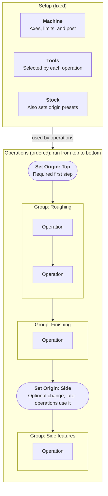
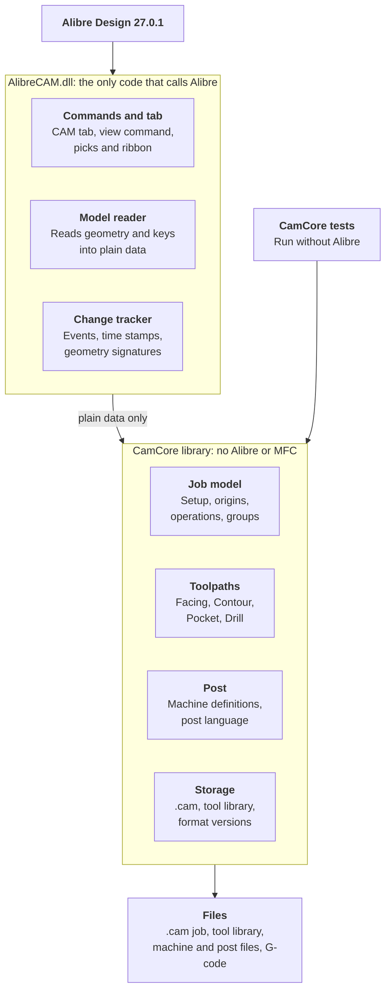

> Exported from the Claude doc "Alibre CAM Add-on: Version 1 Specification" on 3 November 2026 (rev 80).
> The Claude doc is the master copy: https://claude.ai/artifact/JZEKmxczFdEn2eV32A5acB
> The two diagrams are redrawn here in Mermaid, because they don't export from the doc.
> Update this copy after spec changes, or note here if it becomes the master.
# Alibre CAM Add-on: Version 1 Specification

Nov 3, 2026 · @Frank

## Overview

Version 1 is an Alibre Design add-on that generates indexed 3+2 cutting paths for components placed in an assembly and posts them as G-code. The first target is a LinuxCNC 3-axis router with an optional 4th axis.

| Area | In version 1 | Out of scope for now |
| --- | --- | --- |
| Workspace | Assemblies | Parts |
| Motion | Indexed positioning, with 3-axis cutting at each orientation | Simultaneous 4/5-axis motion, including continuous 4th-axis wrapping |
| Operations | Facing, Contour, Pocket, Drill | 3D roughing and finishing, V-carving, engraving, nesting |
| Origin sources | Picked geometry, stock presets | Existing Alibre coordinate systems |
| Regeneration | Started by the user | Automatic regeneration |
| Post-processing | Template-based post language | General scripting in posts |

## CAM tree and workflow

The add-on adds a CAM treeview as another tab in the Design Explorer, with fixed Setup items at the top and the user-built operation sequence below.



Operations run from top to bottom, and each one uses the most recent `Set Origin` step above it. The group names are examples.

The workflow has four steps:

1. Define the machine, tools, and stock in Setup.
2. Set the initial CAM origin.
3. Add operations and organize them into groups.
4. Change the origin when the workflow needs a new orientation.

Toolpaths are visible while the CAM tab has focus and hidden when it loses focus. They are redrawn from saved data, with no recalculation. A toggle sets whether they draw over the model or can be hidden by it, and drawing over the model is the default. A native command ends the display, and a Refresh button on the CAM tab brings it back.

## Stock

Stock can be defined in three ways, and any change to its definition marks dependent origins and operations as out of date.

| Method | User provides | Stock shape |
| --- | --- | --- |
| Manual bounding box | Dimensions and position | Box from the entered values |
| Bounding box around parts | Selected part or parts, and a border | Box around the parts, expanded by the border |
| Imported Alibre part | Another Alibre part | The imported part's shape |

The bounding-box border has six offset boxes: +X, -X, +Y, -Y, +Z, and -Z. Each one adds to the outside of the part on that side, and -Z will typically be 0.

Stock origin presets use the stock's bounding box, including when an imported part isn't a simple box.

An imported stock part stays linked to its source file. The `.cam` file stores the link and the part's position. If the source part changes, the stock and its dependent origins and operations are marked out of date. If the source file is missing, the stock is marked as needing repair.

An imported stock part is positioned by entering its X, Y, Z position and rotation relative to the assembly origin.

## Tools

Tools are stored only in a separate library file, and version 1 starts with flat end mills and drills. A `.cam` file references the tools it uses and doesn't keep its own copies.

| Tool type | Geometry fields |
| --- | --- |
| Flat end mill | Diameter, flute length, overall length, flute count |
| Drill | Diameter, flute length, overall length, point angle |

Both types also have a tool number and a name.

- **Library selection:** The add-on has a default tool library, and a job can override it with a different library file.
- **Library changes:** Editing a tool marks the operations that use it as out of date.
- **Missing tools:** If the library or a referenced tool can't be found, the affected operations are marked as needing repair and can't be posted.
- **Library file:** A library is a JSON file with its own format version. The default is `%APPDATA%\AlibreCAM\tools.json`. A job stores only an override, as a file name if the library sits beside the `.cam` file and as a full path otherwise.
- **Editing:** Double-clicking Tools or a tool opens the library dialog, which can add, edit, copy, and delete tools. Changes save to the library file straight away, separately from the job's manual save.
- **Selected tool:** The Tools node lists the library's tools. Clicking one selects it, and the job stores that selection by tool ID, ready for new operations.
- **Protected libraries:** A library that is damaged or from a newer build can be viewed but isn't changed. A library file that doesn't exist yet is treated as empty.
- **Cutting settings:** Tools hold no spindle speed, feeds, stepdown, stepover, or peck depth, because these vary with the material. Each operation stores its own.
- **Possible extension:** Tools may later hold default cutting settings for different materials, which would fill in a new operation.

## Units

The add-on supports millimetres and inches, and all CAM data is stored and calculated in millimetres.

- **Job units:** Each job has a display unit, which defaults to the assembly's units when the job is created.
- **Tool library:** Each tool stores its own unit, so an imperial cutter keeps its exact size in a metric job.
- **Post output:** The machine definition sets the G-code output unit. The post receives converted values and writes the matching `G21` or `G20`.
- **Display changes:** Changing the display unit doesn't change the toolpaths.
- **Testing:** Unit conversion needs thorough testing, because an error could damage the machine or the part.

## CAM origins and 3+2 machining

Each `Set Origin` step defines a position and orientation, and its Z axis is the tool axis. Every operation is calculated as standard 3-axis toolpaths in the active origin's coordinate system.

|  | Geometry method | Stock preset method |
| --- | --- | --- |
| Position | Nearest end of a picked edge, or the centre of a circular edge. Vertices can't be picked in an assembly | Preset point, such as top-centre or a top corner |
| Z axis (tool axis) | Picked face or edge | Set separately |
| X axis | Optional picked edge; otherwise calculated | Set separately |
| Linked to | Picked geometry | Stock |

The geometry method follows these rules:

- **Z from a flat face:** Z points out of the material, so the tool comes down onto the face.
- **Z from a cylindrical face:** Z is the cylinder's axis. This suits 4th-axis work.
- **Z from a circular edge:** Z is the circle's axis, pointing out of the material when the edge borders a flat face square to that axis. A circular edge also gives its centre as the position.
- **Z from a straight edge:** Z runs along the edge.
- **Position:** An edge picked for the position. If none is picked, the plane pick supplies it when it's an edge. A face alone gives no position.
- **X from an edge:** A straight edge, projected onto the XY plane, pointing away from the end nearer the click. An edge too close to the tool axis is refused.
- **Calculated X:** Assembly X projected onto the XY plane. If that is within about 6 degrees of the tool axis, assembly Y is used instead.
- **Adjustments:** Flip Z, turn X about Z in 90 degree steps, and offset the origin along its own X, Y, and Z axes in millimetres. The offset is applied last.
- **Display:** Only one origin is drawn: the one a step runs under, which is the selected step if it's a Set Origin, and otherwise the nearest Set Origin above it. While the Set Origin dialog is open, its step is drawn instead. The origin draws X, Y, and Z axes in red, green, and blue. Its XY plane is an outline with grid lines inside, not a shaded fill, because Alibre picks add-on graphics before the model behind them and a fill would block everything behind the plane. The grid runs through the origin, with a round spacing (1, 2 or 5 times a power of ten) giving about 10 squares along the longer side. The plane is also hidden while picking in the view (Set Origin picks and Locate), so its lines can't block an edge. The plane covers the parts, and later the stock, plus 10%. The colour and axis length are fixed for now and will become program settings.
- **Editing:** Right-click Operations to add a `Set Origin`, and double-click a step to edit it. A modeless dialog stays open while you pick in the view, and the view shows a live preview. The first step can be edited but not deleted.

- **Changes:** If the source geometry or stock changes, the origin and every operation that depends on it are marked out of date.
- **Deleted geometry:** If the source geometry is deleted, the origin is marked as needing repair, and its operations can't be posted until it's fixed.
- **Reachability:** Each origin is checked against the machine definition. An origin the machine can't reach is marked invalid, and its operations can't be posted.
- **Multiple solutions:** Where more than one rotary solution exists, a rule or user choice selects one.
- **Future support:** Each toolpath stores a tool axis, which stays constant within an operation in version 1. This leaves room for simultaneous motion later.

| Machine configuration | Valid origins | Rotary output |
| --- | --- | --- |
| 3-axis | Z axis aligned with machine Z | None |
| With 4th axis | Z axis reachable by rotating the one rotary axis | Indexed 4th-axis move between operations |
| Later 5-axis machine | Z axis reachable using both rotary axes | Indexed moves on both axes |

## Operations and groups

Version 1 includes four 2.5D operations, and groups control operations together without sharing their settings.

| Operation | Purpose | Key options |
| --- | --- | --- |
| Facing | Flatten or surface the stock | Stepover, depth, boundary |
| Contour | Cut around outlines and part profiles | Inside/outside, climb/conventional, stepdowns, lead-in/out, tabs |
| Pocket | Clear enclosed areas, with or without islands | Stepover, stepdowns, ramp entry, finish allowance |
| Drill | Make holes along the tool axis | Peck depth, dwell, retract height |

Each operation selects its geometry directly in the assembly, rather than selecting whole components.

| Operation | Selection | Depth comes from |
| --- | --- | --- |
| Facing | Stock top, with an optional boundary | Entered depth from the stock top |
| Contour | Edges or a face outline | Selected geometry, with an optional depth override |
| Pocket | Pocket floor face; inner boundaries become islands | Selected floor, measured against the top of the stock |
| Drill | Circular edges and arcs, cylindrical hole faces, and design points | Hole depth, with an optional override |

Selected geometry is saved as references to the component and its face or edge. If a component moves or changes, the operation is marked out of date. If the selected geometry can't be found, the operation is marked as needing repair.

A group can be used to:

- **Reorder:** Drag the group to move its operations together.
- **Suppress:** Exclude its operations from display and posting without deleting them.
- **Regenerate:** Recalculate all of its operations.
- **Post:** Output only that group, such as when recutting one feature.
- **Show status:** Display the most urgent status of the operations inside.

These rules keep group behaviour predictable:

- **No nesting:** Groups can't contain other groups in version 1.
- **No shared settings:** Tools, feeds, and other parameters stay on each operation.
- **Origins stay outside groups:** `Set Origin` remains a step in the main sequence, so a group can't change the origin partway through.
- **Moves are checked:** Moving a group or operation past a `Set Origin` step changes its active origin, so affected operations are marked out of date.
- **Partial posts stay safe:** Posting one group still outputs the program start, the active origin, and any orientation move it needs.
- **Shown as folders:** In the tree a group is a folder. Right-click Operations and choose Add Folder to add one at the end of the sequence, with no dialog. Its name, such as "Folder 1", is ready to type over. The sequence must start with a `Set Origin`, so Add Folder is unavailable until one exists.
- **Folder menu:** Right-clicking a folder offers Rename, which edits the name in place, and Delete. Deleting a folder that holds operations asks first, and an empty folder is deleted without asking. Below a separator, an Add Holes submenu holds Drill, and an Add 2 1/2 Axis submenu holds Facing. Each opens that operation's dialog for a new operation in the folder.
- **Operations live in folders:** An operation can only be created inside a folder, and runs under the folder's origin. Right-clicking an operation offers Edit, Rename (in place), and Delete, which asks first. Double-clicking it opens its dialog.
- **Dragging to reorder:** Steps are dragged with the mouse and never change level. `Set Origin` steps and folders move among the top-level steps, and the first step must stay a `Set Origin`. Operations move within a folder or into another folder; dropping one on a folder adds it at the end. A line shows where a step will go, a no-entry cursor shows where it can't, and a right click cancels. Nothing can be dragged while a dialog is open.
- **Duplicate:** Set Origin steps, folders and operations each have Duplicate on their right-click menu. A folder's sits before the separator, and the others' last. The copy goes just below the original, and its name gets " (copy)". A folder's copy holds copies of all its operations. Every copy gets a new ID, so it's a separate step. Nothing can be duplicated while a dialog is open.
- **Generate:** The last item on the Operations, folder and operation menus, below a separator. It calculates toolpaths for every operation, a folder's operations, or one operation, then reports how many succeeded and why any failed. It isn't available while a dialog is open. Toolpaths are saved with each operation in its origin's frame, and drawn from what was saved: rapids in red and feeds in blue, with the selected operation's bolder, or every operation's in a selected folder. They're hidden while picking in the view. Editing an operation discards its toolpath until it's generated again.
- **Drill toolpath:** For each feature in the list's order, the tool moves across at the clearance plane (rapid first, then rapid or the transfer feed), rapids down to the approach distance above the hole's top, and drills at the plunge feed. With a peck depth it returns to the approach height between pecks, then rapids back to 0.5 mm above where it stopped. The dwell follows (revolutions are converted with the spindle speed), then it feeds back up to the approach height at the retract feed and rapids to the clearance plane. At bottom puts the hole's top a depth above the picked geometry. Add drill tip to depth adds the drill's point length, worked out from its diameter and point angle. Automatic clearance is 5 mm above the parts until it's decided. Stock max Z fails until stock exists. A clearance plane below a hole's approach height fails too. Facing doesn't generate yet.
- **Operation dialog:** A modeless dialog with a name and tabs. Every operation has Features (its geometry), Tool (a drill or flat end mill), Feeds & Speeds, and Clearance, and other operations will add Sorting. Drill and Facing have no Sorting tab. Facing adds a Facing tab, still to be built. Drill adds a Drilling tab. Depth is how far to drill, with Add drill tip to depth, and a Locate button that measures along the origin's Z from its XY plane to a picked point, plane, face or edge. Locate stores only the number. A plane is measured where the drill axis through the origin meets it, and a line at its point nearest that axis. Anything parallel to the drill direction has no answer, and anything over 10 m away counts as none, so both measure as 0. Location of cut geometry is at top or at bottom. Dwell is off, a time in seconds, or a number of revolutions. Engage/retract has an approach distance, and Options has a peck depth, left blank to drill in one pass. The tabs are built one at a time.
- **Features tab:** A list of the operation's picked geometry, in the order it's machined, showing each feature's type, part, diameter, and X, Y and Z in the operation's origin frame. Rows are dragged to reorder them, and deleted with the Delete key, the right-click menu, or the Delete button. Choosing rows selects those features in the view. While Select Features is running the view's selection is the whole list, so the focused row is highlighted instead. The selection is cleared when the dialog closes. Select Features turns the view's selection into the list: the listed features start out selected, Ctrl+click adds or removes one, the list updates as the selection changes, and Done ends it. Features still selected keep their place, and new ones are added at the end. Sort reorders the list by Minimum distance (from the first feature, always to the nearest one left) or Directional (zigzag rows, X first or Y first, from a chosen start corner: top left, top right, bottom left or bottom right; features within 0.5 mm count as one row). Each operation type has its own filter. Facing accepts flat faces, and straight or circular edges around the area to face. The edges don't need to make a closed shape. Drill accepts things that reduce to a point: circular edges and arcs (their centre), cylindrical hole faces (the centre of the end nearer the origin's +Z), and design points. Alibre refuses vertex selection in an assembly. Design points have no persistent key, so they stay in the list but can't be selected again later.
- **Tool tab:** Lists every tool in the job's library (T number, name, type). Beside it, a read-only table shows the chosen tool's properties in its own unit. The operation stores the tool by ID. A new operation starts with the tool selected in the tree. A tool missing from the library stays stored, and the tab says so. Later the list will show only tools that suit the operation, so a drill can't be chosen for milling.
- **Feeds & Speeds tab:** Spindle Speed in RPM. Feed Rates for Plunge, Approach, Engage, Cut, Retract and Departure. Transfer moves between cuts either Use Rapid or Set a feed. Feeds are in mm/min, and in/min once the job's display unit exists. Every value must be more than 0, and the transfer feed is checked only when it's set. The defaults (18,000 RPM, 300 plunge, 500 approach and engage, 1,000 cut, retract and departure, 3,000 transfer) are placeholders until tools can hold per-material defaults.
- **Clearance tab:** One group, Clearance Plane Definition, chooses where the clearance plane sits, along the Z axis of the operation's origin: Automatic, Part max Z + a distance, Stock max Z + a distance, or an Absolute Z value. Only the chosen option's box is enabled, and each value is kept when switching. The distances can't be negative, and an absolute Z can be any value. How Automatic is worked out, and how the stock options behave before stock exists, is decided when toolpaths are built.

## Out-of-date tracking

Changes mark toolpaths as out of date, and regeneration is always started by the user. This keeps Alibre responsive during batches of assembly edits.

Each operation records what its toolpath was calculated from. A change to any of these marks the operation as out of date:

- Target component geometry and position
- Active origin
- Tool, stock, and machine settings used by the operation
- Operation parameters

The interface and posting follow these rules:

- **Visibility:** The tree shows an out-of-date icon on each affected operation and its parent group.
- **Regeneration:** The user can regenerate one operation, one group, or everything that's out of date.
- **Posting:** The add-on warns about out-of-date operations and blocks posting by default.
- **Display:** Out-of-date toolpaths stay visible at their old position until they're regenerated.
- **Between sessions:** The `.cam` file saves a geometry signature for each reference: its extents, surface or curve values, and the occurrence's transform. On opening, a mismatch marks the operation as out of date. A change that leaves the selected geometry identical isn't detected, and this limit is accepted for version 1.
- **During a session:** Session events and time stamps detect changes. Time stamps aren't saved, because they reset after a restart.

## Machines and post-processing

Machines are configurable, and each one uses a post written in a simple template language. The first target is a LinuxCNC 3-axis router with an optional 4th axis.

- **Machine definition:** Axes, travel limits, rotary setup, spindle limits, and which post to use. Rotary setup defines each rotary axis's orientation, which can be along any direction.
- **Post file:** How motion and machine events are written as G-code. It maps events to templates, with number formatting and a few simple conditions.
- **Orientation changes:** The post outputs a safe retract and rotary move, then continues with 3-axis motion.
- **First post:** It calculates coordinates for the active rotary position, and doesn't rely on tilted-plane commands.
- **True 3+2 testing:** The first machine has at most one rotary axis, so this needs a two-rotary machine definition and simulated output.
- **Tool changes:** The first router uses manual tool changes and a touch plate. For now, the post handles this, so the add-on doesn't need its own tool-change or touch-plate logic.
- **4th-axis test setup:** The test router's 4th axis runs along the machine's Y axis.
- **Operator responsibility:** The operator positions and zeroes the physical 4th axis, and sets the CAM origin to match it. The machine configuration doesn't store a measured centre position.
- **Work zero:** A job uses one work zero. The first CAM origin and physical work zero are set on the rotary axis, and the post calculates all coordinates around them. Later `Set Origin` steps define new orientations and don't require re-zeroing.

This illustrative post shows the intended style. The syntax isn't final, and real routers may need different retract and tool-change blocks.

```text
post "LinuxCNC Router"
extension ".ngc"

format linear "%.4f"
format rotary "%.3f"

on program_start
  (PROGRAM {program_name})
  {unit_code} G90 G17 G54
end

on tool_change
  M5
  G53 G0 Z0
  T{tool} M6
  G43 H{tool}
  S{spindle} M3
end

on orientation_change
  G53 G0 Z0
  if has_a: G0 A{a}
end

on rapid
  G0 X{x} Y{y} Z{z}
end

on linear
  G1 X{x} Y{y} Z{z} F{feed}
end

on arc
  {arc_code} X{x} Y{y} Z{z} I{i} J{j} F{feed}
end

on program_end
  M5
  G53 G0 Z0
  M30
end
```

If a controller needs more than this, language features are added as real cases come up.

## CAM file

CAM data is saved in a separate `.cam` file next to the assembly, such as `Bracket.AD_ASM` and `Bracket.cam`.

- **Pairing:** The file is found by matching its name and location to the assembly, then confirmed using the assembly identity stored inside it.
- **References:** The file stores references to components. On opening, the add-on checks them and marks anything it can't match as needing repair.
- **Windows file association:** Other software also uses `.cam`, so version 1 doesn't register the extension. Files are opened through the add-on.
- **Format:** Each file includes a format version number so older files can be migrated. Version 2 added `Set Origin` steps, which store their picks with persistent keys plus the options. Groups store their operations in order. The frame is recalculated on loading rather than stored.
- **Future changes:** All saving and loading go through a single storage layer, so the data can move into the assembly later without rewriting the CAM logic.
- **Saving:** A Save button on the CAM tab writes the file, separately from saving the assembly. It writes a temporary file first, so a failed save leaves the existing file as it was.
- **Protected files:** A file from a newer build or one that can't be read isn't opened, and saving stays off so it can't be overwritten.
- **Different assembly:** If the stored GUID doesn't match, the add-on asks before using the file. Answering No leaves the file alone and turns saving off.
- **Unsaved changes:** Saving stays manual. Closing the tab or the assembly with unsaved changes asks whether to save them. Alibre can't cancel the close from here, so the choice is only Yes or No. If the assembly was never saved, a warning says the changes can't be kept.

## Add-on structure

Proposed for review: the add-on splits into a thin layer that calls Alibre and a separate CAM library that doesn't. The project is at `D:\Projects\alibre\AlibreCAM`, and `camtest` stays as the API test bed.



The add-on layer reads Alibre's geometry into plain data, and the library works only on that data. Toolpaths, posts, and file formats can then be tested with no Alibre running.

```text
AlibreCAM\
  AlibreCAM.sln
  addon\      AlibreCAM.dll: tab, commands, model reader, change tracker
  core\       CamCore library: job model, toolpaths, post, storage
  tests\      CamCore tests
  machines\   Machine definitions and post files
  deploy\     Install and uninstall scripts
```

These rules build on the proof of concept's results:

- **Calculation thread:** Alibre calls stay on the UI thread. Geometry is read first, so toolpaths can be calculated on a worker thread and Alibre stays responsive.
- **Drawing:** Toolpaths are prepared once as point arrays and rebuilt into graphics on every render, drawing only the selected operation or group where possible.
- **Units:** The model reader converts Alibre's model units to millimetres, so nothing below it sees Alibre's units.
- **References:** Each saved reference holds the occurrence key, the target key, and a geometry signature. A failed bind marks it as needing repair.
- **Events:** The change tracker combines rapid events during a drag and ignores sessions opened for stock.
- **Version check:** The add-on greys its commands out below build 27039.

The proposed build order proves the whole route to G-code early:

1. Done: CAM tab, empty tree, and saving and loading the `.cam` file.
2. Tool library, and selecting a tool in the tree.
3. `Set Origin` and its drawing in the view.
4. Drill: picking geometry and drawing the toolpath with the selected tool.
5. Machine, post language, and stock, through to G-code that can be cut on the router.
6. Facing, Contour, and Pocket.
7. Groups, out-of-date marking, and repair.
8. Indexed 4th axis.

The `.cam` file uses JSON with a format version number. `CamCore` uses these external libraries, each pinned to a release tag and copied into `third_party\` with its licence:

| Library | Purpose | Version | Licence |
| --- | --- | --- | --- |
| [Clipper2](https://github.com/AngusJohnson/Clipper2) | Polygon offsetting and boolean operations | 2.0.1 | Boost Software License 1.0 |
| [nlohmann/json](https://github.com/nlohmann/json) | Reading and writing the `.cam` file | 3.12.0 | MIT |
| [doctest](https://github.com/doctest/doctest) | `CamCore` tests only; not shipped | 2.5.3 | MIT |

[Clipper2 works only on straight-line paths](https://angusj.com/clipper2/Docs/Overview.htm). Contour and Pocket outlines are therefore flattened to line segments before offsetting, so true `G2`/`G3` arcs on those paths would need an arc-fitting step.

## Items to confirm

The product decisions above are settled, but these details and Alibre API capabilities needed to be confirmed first. All of them are now settled, and the proof of concept tested the API items.

**Details to decide**

- [x] How is stock defined: manually entered dimensions, a bounding box around selected components, or both?
- [x] Is the bounding-box border one value for all sides, or set separately per side?
- [x] How is an imported stock part positioned in the assembly?
- [x] Which tool types and fields does version 1 need, and are tools stored in each `.cam` file or a shared library?
- [x] Is there one tool library per computer, or can each job choose its own library file?
- [x] How does an operation select its targets, such as components, faces, edges, or holes?
- [x] Which units does the add-on support, and how do they interact with the post?
- [x] Does the router use an automatic or manual tool change?
- [x] Which axis does the 4th axis rotate around, and how is its centre position measured?
- [x] After a rotary move, are toolpath coordinates calculated around the first origin, or does the operator set a new work zero for each `Set Origin`?

**Alibre API checks**

- [x] Can an add-on host the CAM treeview alongside Alibre's existing tree?
- [x] Can it draw toolpaths and origins in the assembly's 3D view?
- [x] Can it pick points, faces, and edges inside an assembly?
- [x] Can it read each component's geometry and position?
- [x] Can it detect or compare model changes to drive out-of-date marking?
- [x] Can it get stable identities for the assembly, components, and picked geometry across sessions?
- [x] Can it load another Alibre part, read its shape, and display it as stock?
- [x] Can it detect when the CAM tab gains or loses focus, and start or end the toolpath display from that?

**API review so far**

The proof of concept ran these checks on Alibre Design 27.0.1.27039, and the results below answer them. Version 1 targets this version, while the documentation describes AlibreX v29, so each call must be checked against the 27.0.1 type library.

**Proof of concept results**

- **Tab and focus:** The CAM tab and tree work. `IsWindowVisible` detects tab focus, and `InvokeNewCommand` starts and stops the view on each change.
- **Drawing:** Alibre drops add-on graphics on each render, so they must be rebuilt in every `On3DRender`. With that, they survive pan, zoom, and hover. A 10-unit reference square measured 100 mm in a centimetre assembly. Foreground on draws them over the model, and foreground off lets the model clip them.
- **Drawing cost:** A 200,000-point polyline takes 47 ms to build and limited redraws to about 9 per second.
- **Native commands:** Measure ends the view. The CAM tab stays open, but the toolpaths don't return when Measure is cancelled.
- **Picking:** Edges, planar faces, and cylindrical faces can be picked in the assembly while the view is active. Pocket faces report inner and outer loops, and cylinders report their axis and radius.
- **Pick filters:** Setting faces, edges, or parts from the add-on reads back correctly. Picks on those settings returned that type. Both vertex settings are refused with hr=0x8004032B, and the filter keeps its previous value.
- **Coordinates:** The clicked point is in assembly coordinates. A click on a rotated part's edge lands on that edge after applying `WorldTransform`, so translation and rotation are both right.
- **Saved references:** Occurrence keys bind in the assembly session, and face and edge keys bind in the part's session, not the assembly's. All 21 saved picks bound after a restart, an added feature, a dimension change, and a feature deletion. Bound edges and faces reported their new size after the dimension change. After a feature that owned two picked faces was deleted, those two binds failed with hr=0x8000FFFF and the other 21 still bound, so a failed bind can trigger needs repair.
- **Events:** Session events connect through the vtable interface. Moves arrive as change types 307 and 48 and name the occurrence. Part edits arrive on the assembly session as add, modify, and remove types, mostly with no object, so they say something changed but not what.
- **Time stamps:** Within a session, they changed only on the part that was edited, and one unaffected face kept its value through an added feature. They can go down as well as up, so they must be compared for inequality. An edge reported 20 in one Alibre session and 5 after a restart, so they can't be saved in the `.cam` file.
- **Stock:** `OpenFileEx` opened a part in 187 ms with no editor window. Its facet data gave 12 triangles and a bounding box, which the view drew correctly, and it closed cleanly. Its open and close events arrived after the close, so the add-on's event handler must ignore them.

Face and edge keys are gzip-compressed text that describes topology, such as `-1_[{512,0,1,0,3,BF}]`, and occurrence keys hold a GUID. The same edge kept its key across an Alibre restart, but two different parts can share a face key, so a saved reference must pair the occurrence key with the target key. Keys also stayed stable after model edits, as the saved references results above show.

Two findings affect the design:

- **Model units:** All API values use the workspace's model units. These are centimetres for new workspaces, but an imported workspace can use another unit, so the add-on must read `ModelUnits` rather than assume centimetres.
- **Future storage:** An add-on can store its own stream inside the Alibre file using `<PersistentData>`, `SaveData`, and `LoadData`, so moving CAM data into the assembly later is supported.
